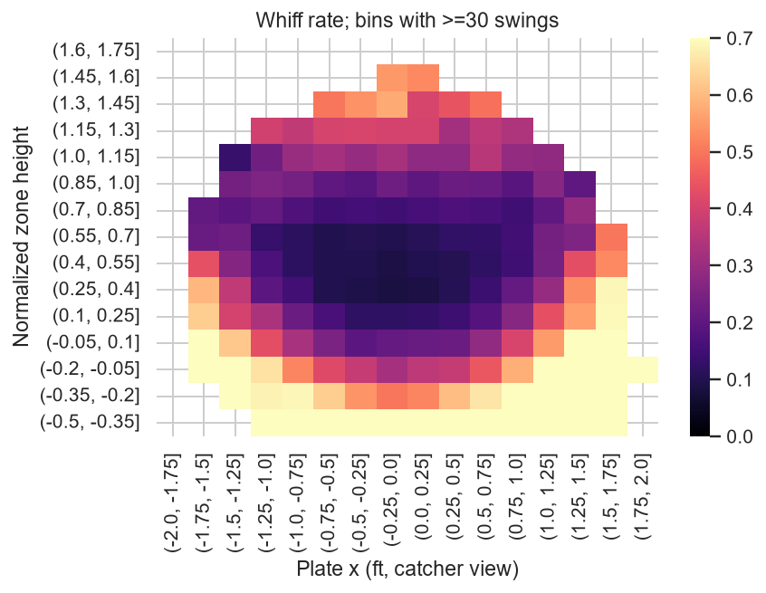
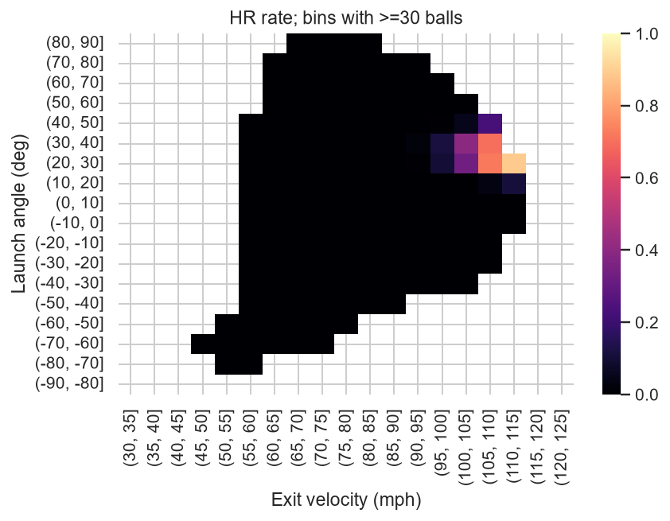
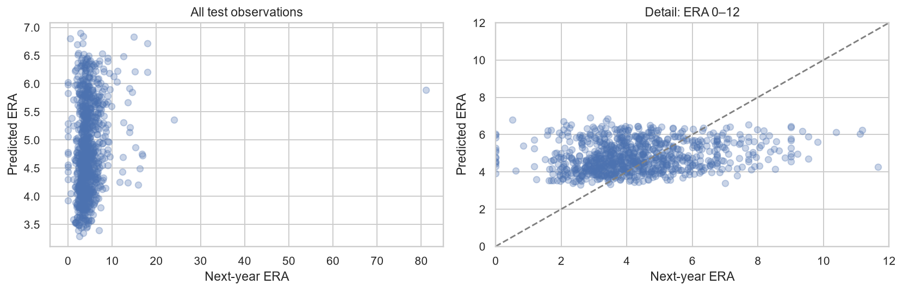

# MLB投球・打球データの分析と翌年ERA予測：分析レポート

分析実行日：2026-10-31。文書更新日：2026-11-01。対象期間の確定結果を用いた回顧的分析であり、実行日時とモデルが利用する情報の時点は区別する。再取得時のデータ訂正により、結果が変動する可能性がある。

## 要旨

MLB Statcastの2025年4〜5月の投球データと、FanGraphsの2018〜2025年の投手シーズン成績を用い、空振り要因、本塁打確率、翌年ERAの3テーマを検討した。対象定義と情報の利用時点を明示し、前処理を訓練データ内で学習したうえで、時間順に分離した検証・テストデータでモデルを比較した。

空振り分析では110,368スイングを対象とし、選択したRandom Forestのテストlog lossは0.4407で、定数確率モデルの0.5322を下回った。本塁打分析では計測済み41,158打球を対象とし、テストlog lossは0.0630、定数確率モデルは0.1710だった。いずれも実測された投球位置・打球条件に基づく結果推定であり、投球前・打席前の予測とは区別する。

翌年ERA分析では3,006投手年を対象とし、選択モデルのテストRMSEは3.452、前年ERAの持越しは3.653だった。一方、訓練平均による予測は3.503であり、平均予測に対する改善の95%区間は0を含んだ。個人別予測の追加価値は限定的で、翌年の少数登板による極端値と対象選択が主要な制約となった。

## 1. 問題設定

本プロジェクトでは「記録された特徴が結果とどう関連するか」と「未来を予測できるか」を分けた。空振りと本塁打は、投球・打球後の条件付き推定。翌年ERAだけが将来予測である。比較するモデルは事前に少数に固定し、検証データで選択した後、テストデータでは固定ベースラインとの比較だけを行った。

仮説は、①空振りは速度だけでなく位置・球種・左右との組合せに依存、②本塁打は速度と中程度の正の角度の非線形な組合せに依存、③翌年ERAには単純持越しより周辺指標と縮小が有効、の3つ。いずれも因果仮説を実験的に検証したものではない。

## 2. 取得と品質

Statcast 2025年4〜5月の234,985球を取得。全61日が存在し、投球キー `game_pk, at_bat_number, pitch_number` で重複を排除。全件がレギュラーシーズンだった。①は110,368スイング、②はインプレー41,310球のうち計測値・結果がある41,158球。②の除外は152球（0.37%）で、欠損がランダムであることまでは検証していない。詳細は各selection.csv・missingness.csvに保存した。

FanGraphsは2018〜2025年の順に799、831、735、909、871、863、855、873投手シーズン、計6,736件。pybaseball 2.2.7の旧HTML解析が空応答だったため、同じFanGraphsのランキング用JSONに切替えた。投手IDはランキングのIDを用い、必要な場合だけ名前セルのリンクから抽出。投手ID×年度の重複0件を確認し、1対1結合を強制した。

当年20IP以上・当年2018〜2024年は3,602件。翌年ERAが得られた3,006件を予測対象とし、596件（16.5%）は非観測として除外。年別の非観測件数は76、123、19、101、87、95、95件だった。2020年は短縮シーズンのため20IP条件自体が他年と異なる意味を持つ。

生データと再配布権を区別し、Parquetは公開対象外。出典・利用条件は [DATA_SOURCES.md](../DATA_SOURCES.md)、実際の取得時刻・件数・ハッシュ・失敗は [acquisition.jsonl](acquisition.jsonl) に記録した。自由なデータ再配布の許諾があるという主張はしない。

## 3. 空振りの要因

バントを除くスイングを分母とし、空振り25,182球（22.82%）。foul_tipを空振りに含めず、見逃しは分母にも入れない。投球位置は実測値であるため、試合前の予測精度ではない。

球種別空振り率はSL31.3%、FS31.4%、CH28.9%、FF18.2%、SI11.9%。KNは1球しかなく、率0%を球種性能の証拠にしない。球速帯では80〜85mphが29.1%、90〜95mphが16.8%、100mph超が26.5%で、単純な単調増加ではなかった。これは遅い変化球と速球の構成差も含む集計である。

左右（投手→打者）ではL→L25.0%、L→R22.8%、R→L21.7%、R→R23.5%。同じ左右同士で高い傾向があるが、投手・球種構成を揃えた因果効果ではない。率のWilson区間は独立試行近似の記述用にとどめる。

位置図は打者別ゾーンを0〜1に正規化し、各セル30スイング以上に限定。中央付近の率が低く、端・ゾーン外で高い。ただし見逃しは分母にない。ゾーン外を増やすと四球やスイングされない球も増え得るため、「そこへ投げれば良い」という結論にはならない。

訓練データのGLMに球速×高さ、左右×左右、位置の二乗を含め、試合cluster robust標準誤差を推定。球速×高さの係数は0.0548（95%区間0.0405〜0.0691）。球速の主効果は−0.000095（−0.0102〜0.0100）で、モデル内では高さ0における効果である。交互作用があるため、この主効果だけで「球速は無関係」と結論しない。モデル仕様、多重比較、交絡に注意する。[係数全表](whiff_inference.csv)

訓練53,691球、検証26,906球、テスト29,771球。検証log lossは定数0.5328、基本ロジスティック0.5050、特徴追加0.4843、RF葉20 0.4369、RF葉50 0.4414。球速×高さ・回転・変化量の追加は線形モデルを改善したが、RFの葉を大きくすると悪化した。

選択したRF葉20のテストlog loss0.4407、ROC-AUC0.7678、AP0.5597、Brier0.1388。テスト陽性率22.41%に対し、定数モデルのAPは0.2241。log lossの定数比改善は0.0915、試合ブートストラップ95%区間は改善方向に0.0865〜0.0958だった。校正図もNotebookに保存した。

実務的には、球種別の率だけで評価せず、位置・左右・速度帯を合わせて比較することが出発点になる。選手ごとの配球最適化や球種変更の推奨には、見逃し・四球・被打球結果を含む目的関数と別の検証が必要である。

## 4. 打球速度・角度と本塁打

本塁打は1,706/41,158球（4.15%）。対象はインプレーの計測済み打球であり、ファウル・空振りを含む打席全体の確率ではない。

105〜110mph・20〜30度は478/662（72.2%、Wilson 95%区間68.7〜75.5%）。同じ速度で30〜40度は160/230（69.6%、63.3〜75.2%）。110〜115mph・20〜30度は103/116（88.8%、81.8〜93.3%）だが、より小さい標本である。これらは全期間EDAで見出した領域であり、別標本で確認された最適角度ではない。

速度と角度の二乗・積を入れた訓練ロジスティックモデルと試合cluster robust区間を [hr_inference.csv](hr_inference.csv) に保存。数値安定性のため `ev10=(速度−90)/10`、`la10=(角度−20)/10` とした。元のGLMでは確率がほぼ0の領域でsandwich共分散が欠損したため、安定したスコア計算を使うLogitへ変更し、係数・区間・p値が全て有限値であることを確認した。係数は基底項が相互に関連し、そのまま1単位の単純効果として読まない。観測範囲外へ外挿しない。

特に速度×角度の係数は−0.550、95%区間−1.132〜0.033で0を含む（探索的p=0.065）。このモデルで交互作用単独が統計的に支持されたとは言わない。二乗・積をまとめて追加した際の予測改善と、個別係数の有意性は別の問いである。

訓練19,887、検証10,139、テスト11,132球。検証log lossは基本ロジスティック0.1073→二乗・積の追加0.0702→RF葉20 0.0620→RF葉50 0.0615。速度・角度を直線で扱うモデルより、非単調性を表すモデルが良かった。

選択したRF葉50のテストlog loss0.0630、ROC-AUC0.9823、AP0.7112、Brier0.01969。定数log loss0.1710に対する差の95%区間は−0.1182〜−0.0982。Accuracyは定数でも95.9%、選択モデル97.2%なので、Accuracyだけでは不均衡下の性能を十分に説明しない。

高い性能の理由の一つは、打球速度・角度が既に結果に近い情報であること。打席前の高精度予測を達成した意味ではない。球場・風・気温・左右方向・フェンス距離・打者特性を含まないため、同じ速度・角度に残る結果差を説明しきれない。試合時期・計測条件の変化による校正ずれも残る。

## 5. 翌年ERAの予測

当年情報だけで翌年ERAを予測。IPの `.1/.2` は1/3・2/3回へ変換してモデル特徴に使用し、投手名・ID・翌年IP・翌年役割は特徴に入れない。翌年非登板をERA0としない。目的年2019〜2022年の1,646件を訓練、2023年459件を検証、2024〜2025年901件を固定テストとした。同じ投手の年を跨ぐ出現は、既存投手の将来を予測する目的に沿って許す。

相関図はERA・FIP・WHIP・K/9・BB/9等の同年Spearman相関、年次図は20IP以上のERA分布を表示。相関が高いことは翌年の予測力と同じではない。訓練OLSの投手cluster robust区間では、ERA・FIPの係数区間は0を含み、K/9は負方向だった。ただし共線性や選択バイアスがあるため、指標の独立した因果効果を示さない。

| モデル | 検証MAE | 検証RMSE |
|---|---:|---:|
| 訓練平均 | 1.584 | 2.671 |
| 前年ERA | 1.746 | 2.917 |
| Ridge（ERAのみ） | 1.528 | 2.644 |
| Ridge（追加指標） | 1.474 | 2.600 |
| RF葉20 | 1.470 | 2.603 |
| RF葉50 | 1.442 | **2.573** |

MAEとRMSEの順位が一致しない場合も、事前に定めたRMSEで選択した。Ridgeを超えないRF設定もあり、手法名の複雑さだけで性能は決まらなかった。

| 固定テスト | MAE | RMSE |
|---|---:|---:|
| RF葉50 | **1.736** | **3.452** |
| 訓練平均 | 1.775 | 3.503 |
| 前年ERA | 1.854 | 3.653 |

前年ERA比のRMSE改善は0.201（約5.5%）。投手ブートストラップ95%区間は差−0.314〜−0.140。一方、訓練平均比は0.051（約1.4%）で、差の区間−0.092〜+0.002は0を含む。**平均予測より明確に優れているとは言えない**。ERAを平均へ縮めるだけでも有効であり、細かな個人予測の追加価値は限られた。

最も大きい誤差はMatt Kochの2024年（予測5.88、ERA81.00）。出典行を確認すると翌年0.1IP＝1アウト、3自責点であり、単なるデータ入力ミスと見なして削除しなかった。翌年の少数登板は予測時点では未知で、当年指標だけから極端な率を精密に予測するのは難しい。Connor Brogdonの2024年、Cody Poteet・Kyle Gibsonの2025年等も大きい誤差となった。[テスト予測・誤差](era_test_predictions.csv)

当年IP別では20〜50IPの277件でMAE2.498・RMSE5.538、100〜150IPの109件でMAE1.272・RMSE1.567。当年10先発以上では2024/2025年のMAE1.291/1.261、10先発未満は2.124/1.875。これらはテスト後の診断であり、モデル選択に使わない。IP閾値や先発判定の別設定で汎化が改善することを示した実験ではない。

制約は、翌年登板する投手に条件付ける生存者バイアス、当年20IPによる短期登板者の除外、2020年の短縮、投球回で重み付けしない投手単位の評価、故障・球速変化・球場・守備・役割変更の未観測である。今後は非登板確率と登板時成績を分けた二段階モデル、年次ごとのローリング検証、投球回の不確実性を含む率の階層モデルを、別の評価計画で検討できる。

## 6. 再現性と検証範囲

全Notebookをローカルキャッシュから順に実行し、表・図の出力とエラー0件を確認。前処理Pipeline、対象定義、連続年結合、時間分割、IP表記変換を最小テストで確認した。環境の全依存をrequirements-lock.txtに記録。Notebookの実行はrun.pyから再現できる。

テストでは選択モデルと事前に決めた定数／前年ベースラインだけを評価した。ERAの追加の平均ベースライン区間は固定モデルの診断であり、再選択には使っていない。モデル再訓練を含むブートストラップ、年度を標本単位とした推論、別年度の外部テスト、他OSでの実行、新規環境での初回取得の再検証は未実施である。取得元の将来互換性・生データの再配布権も保証しない。

## 7. 結論と今後の課題

空振りと本塁打では、基本的なロジスティック回帰に特徴量を追加することで検証性能が改善し、Random Forestがさらに低いlog lossを示した。これらの結果は、投球・打球条件の非線形な関係を考慮する有用性を示す。ただし、スイングや計測済み打球に条件付けた観察分析であり、球種変更や打撃動作変更の因果効果を示すものではない。

翌年ERAでは前年ERAの持越しを改善したが、平均予測を明確に上回る証拠は得られなかった。個人別成績の予測では、モデルの複雑化に加え、登板機会と率指標の変動を扱う対象設計が重要である。

今後は、別年度での外部検証と年次ローリング検証を優先する。空振り分析では見逃し・四球・被打球結果を含む評価、本塁打分析では球場・打球方向などの追加、ERA分析では翌年登板の有無と登板時成績を分ける設計を検討する。追加分析でも、モデル選択用データと最終評価用データを分離し、予測性能と適用範囲を併せて評価する。
